# ARCHITECTURE — ACN ERP

**Project:** ACN ERP  
**Document:** ARCHITECTURE.md  
**Architecture Type:** Modular Backend + SPA Frontend  
**Backend:** CodeIgniter 4  
**Frontend:** Vue 3 + TypeScript  
**Database:** MySQL  
**Purpose:** Dokumentasi arsitektur teknis dan hubungan antarkomponen ACN ERP.

---

# 1. ARCHITECTURE PRINCIPLES

Arsitektur ACN ERP mengikuti prinsip:

1. Separation of Concerns.
2. Modular Architecture.
3. Centralized Authorization.
4. Backend-driven Business Logic.
5. API-based Communication.
6. Reusable Core Services.
7. Database Integrity.
8. Minimal Coupling.
9. Controlled Extensibility.
10. Backward Compatibility.

AI harus mempertahankan prinsip tersebut ketika mengusulkan atau menerapkan perubahan.

# 2. HIGH-LEVEL SYSTEM ARCHITECTURE

Gambaran umum arsitektur:

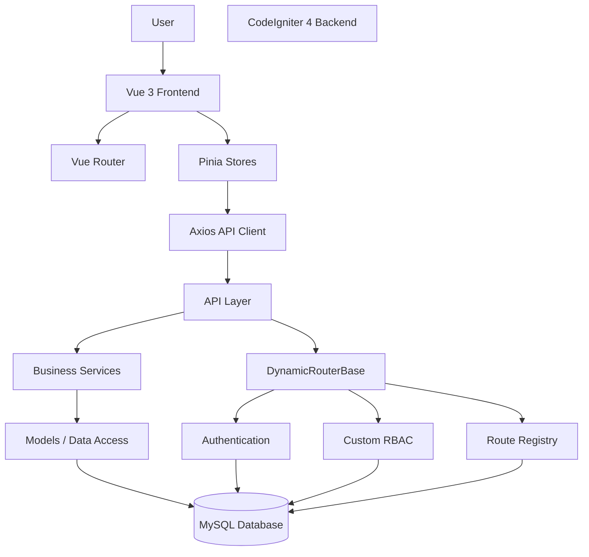

**Catatan:** Diagram ini merupakan gambaran konseptual berdasarkan pembahasan. Urutan pemanggilan aktual harus diverifikasi melalui implementasi source code.

# 3. BACKEND ARCHITECTURE

## 3.1 Backend Responsibilities

CodeIgniter 4 merupakan pusat pemrosesan backend ACN ERP.

Tanggung jawab backend:

- Authentication.
- Authorization.
- Routing.
- Validasi request.
- Business logic.
- Pengelolaan transaksi.
- Akses database.
- Audit dan logging.
- API response.
- Integrasi eksternal.

Frontend tidak boleh mengambil alih tanggung jawab keamanan dan business logic yang menjadi kewenangan backend.

## 3.2 Backend Layer Concept

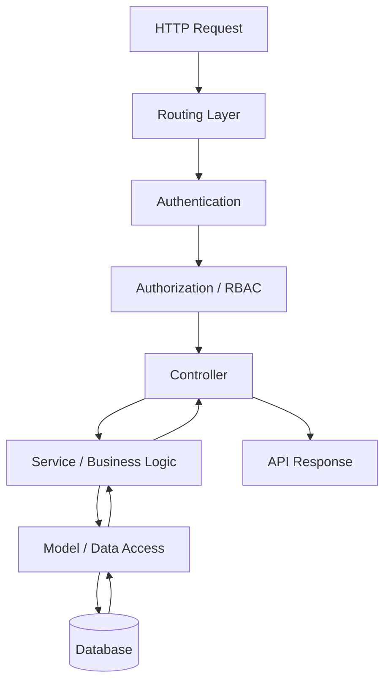

Diagram menunjukkan pemisahan tanggung jawab, bukan ketentuan bahwa seluruh endpoint harus mempunyai urutan identik.

# 4. DYNAMIC ROUTER ARCHITECTURE

DynamicRouterBase merupakan komponen penting dalam pengelolaan routing backend.

Komponen yang pernah dikembangkan:

```text
DynamicRouterBase
├── RouterConfig
├── ControllerScanner
├── MethodPolicy
├── RouteResolver
├── AuthenticationResolver
├── AccessChecker
├── HttpVerbPolicy
├── RateLimiter
└── RouterResponseHandler
```

## 4.1 Component Responsibilities

| Component | Tanggung jawab |
|---|---|
| RouterConfig | Membaca konfigurasi routing |
| ControllerScanner | Menemukan controller dan method |
| MethodPolicy | Menentukan kebijakan method |
| RouteResolver | Menentukan resolusi endpoint |
| AuthenticationResolver | Mengelola kebutuhan autentikasi |
| AccessChecker | Memeriksa hak akses |
| HttpVerbPolicy | Mengatur HTTP verbs |
| RateLimiter | Membatasi request |
| RouterResponseHandler | Menangani response routing |

## 4.2 Dynamic Routing Concept

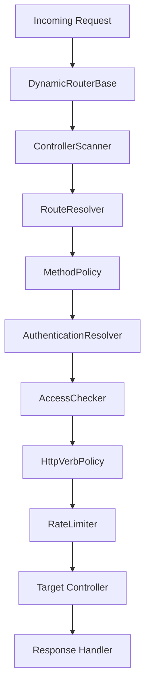

**PERLU VERIFIKASI:** Urutan aktual, kondisi bypass, exception, dan interaksi antarkomponen harus diperiksa dari source code DynamicRouterBase terbaru.

AI dilarang mengubah urutan atau kebijakan keamanan berdasarkan diagram konseptual ini saja.

# 5. ROUTE REGISTRY ARCHITECTURE

Route Registry merupakan pusat pengelolaan informasi endpoint.

Tabel yang diketahui:

```text
route_registry
route_registry_verbs
route_registry_menus
```

Fungsi utama:

- Menemukan endpoint.
- Mendaftarkan endpoint.
- Mengelola status endpoint.
- Mengatur HTTP verbs.
- Mengelola metadata endpoint.
- Menghubungkan endpoint dengan menu.

## 5.1 Registry Concept

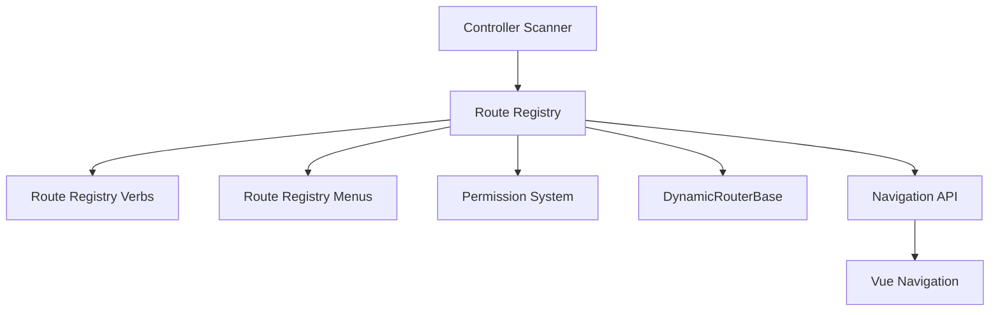

Diagram ini menggambarkan hubungan konseptual. Implementasi relasi dan alur sinkronisasi harus diverifikasi.

## 5.2 Registry Governance

- Route Registry menjadi sumber pengelolaan endpoint.
- Jangan membuat daftar endpoint paralel tanpa alasan.
- Status `is_discovered`, `is_routable`, dan `is_allowed` harus memiliki makna konsisten.
- HTTP verbs harus mengikuti kebijakan yang berlaku.
- Metadata menu harus tetap terhubung dengan endpoint sesuai relasi aktual.
- Perubahan registry harus mempertimbangkan DynamicRouterBase dan RBAC.

# 6. AUTHENTICATION ARCHITECTURE

Authentication menggunakan CodeIgniter Shield dengan penyesuaian kebutuhan ACN ERP.

Arah implementasi Vue browser saat ini adalah session-based authentication.

## 6.1 Authentication Concept

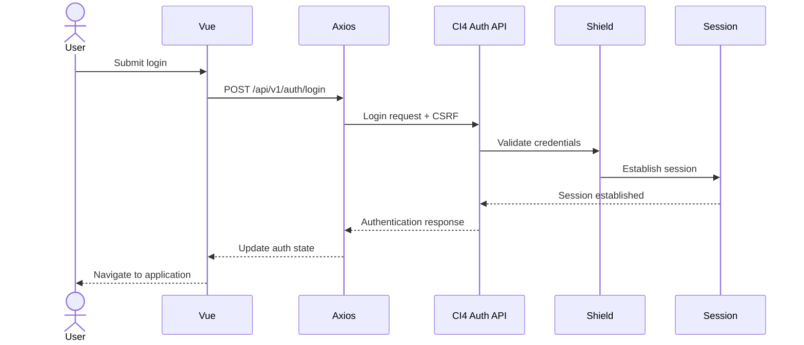

Diagram bersifat konseptual. Detail session regeneration, cookie attributes, CSRF lifecycle, dan response aktual harus diverifikasi.

## 6.2 Authentication Rules

- Backend memvalidasi identitas dan kredensial.
- Session dikelola backend.
- Frontend tidak menyimpan password.
- Authentication state frontend bukan sumber otorisasi.
- Endpoint yang memerlukan autentikasi harus memeriksa session.
- Logout harus membersihkan session sesuai mekanisme backend.

# 7. RBAC ARCHITECTURE

ACN ERP menggunakan custom RBAC.

Shield menyediakan fondasi autentikasi, sedangkan kebijakan RBAC ACN ERP dikembangkan melalui sistem tersendiri.

Komponen yang diketahui:

```text
RBAC
├── RbacService
├── AccessControlService
├── RouteRegistryAccessService
├── Groups
├── Permissions
└── User Assignments
```

## 7.1 RBAC Concept

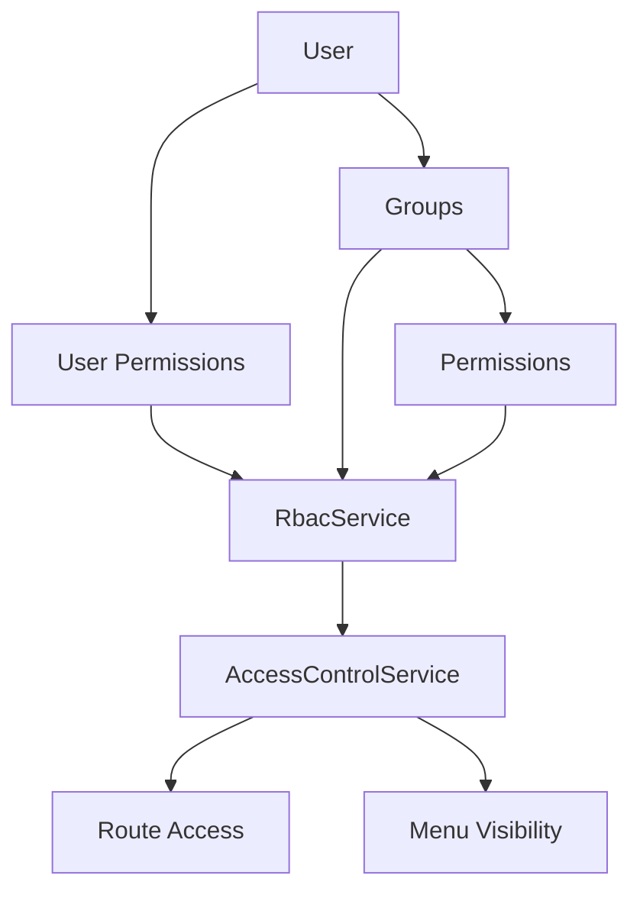

## 7.2 Authorization Rules

- Backend melakukan pemeriksaan permission.
- Menu frontend mengikuti hasil otorisasi backend.
- Route frontend bukan pengganti pemeriksaan backend.
- Permission langsung pada user dan permission dari group harus mengikuti aturan efektif yang diterapkan.
- Superadmin protection harus dipertahankan.
- Jangan mengasumsikan seluruh group otomatis mempunyai akses penuh.

**PERLU VERIFIKASI:** Prioritas permission user versus group, inheritance, deny rules, dan mekanisme override.

# 8. API ARCHITECTURE

API menggunakan pola versioning:

```text
/api/v1/{module}/{endpoint}
```

Contoh endpoint yang pernah digunakan:

```text
/api/v1/auth/login
/api/v1/auth/me
/api/v1/route-registry
```

## 8.1 API Communication

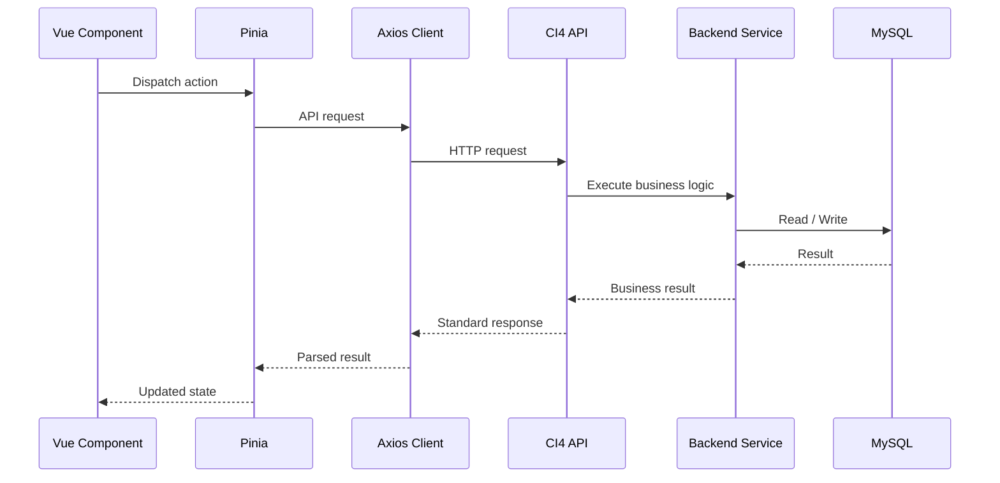

## 8.2 API Contract

Format response standar yang pernah digunakan:

```json
{
  "status": 200,
  "error": false,
  "message": "Success",
  "data": {},
  "csrf_token": "..."
}
```

Aturan:

- Pertahankan kontrak API.
- Jangan mengubah URL tanpa persetujuan.
- Validasi request di backend.
- Terapkan authorization pada endpoint yang dilindungi.
- Tangani error secara konsisten.
- Jangan membocorkan informasi internal atau kredensial.

# 9. FRONTEND ARCHITECTURE

Frontend menggunakan Vue 3, TypeScript, Pinia, Vue Router, Axios, dan Adminmart Modernize.

## 9.1 Frontend Responsibilities

- Rendering UI.
- Navigasi.
- Form interaction.
- Client-side validation untuk pengalaman pengguna.
- Pengelolaan state.
- API communication.
- Penyajian menu berdasarkan data backend.
- Pengelolaan tampilan berdasarkan hak akses.

Frontend tidak menjadi sumber kebenaran untuk permission dan business rules.

## 9.2 Frontend Component Relationship

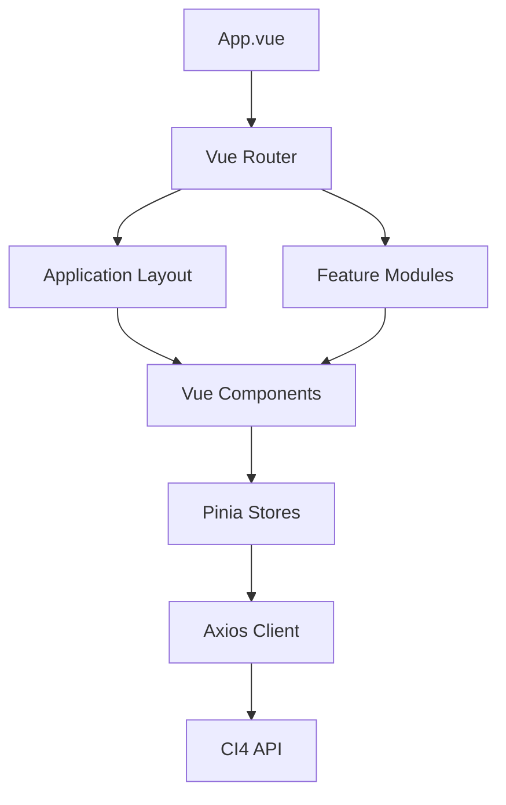

## 9.3 Module Routing

Setiap module dapat mempunyai file router tersendiri.

Pola yang pernah digunakan:

```text
frontend/src/modules/*/router.ts
```

Pendaftaran route dilakukan melalui mekanisme auto-discovery yang harus diverifikasi dari implementasi router terbaru.

# 10. MENU & NAVIGATION ARCHITECTURE

Menu ACN ERP mengikuti konfigurasi backend.

Konsep alur:

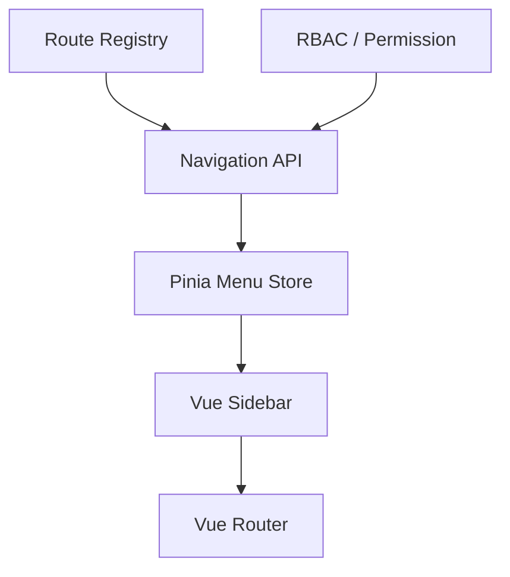

Prinsip:

- Backend menentukan menu yang dapat diberikan kepada user.
- Vue menampilkan menu.
- Sidebar tidak melakukan perhitungan RBAC sendiri.
- Route frontend harus tetap memiliki guard untuk pengalaman navigasi.
- Backend tetap memvalidasi setiap request yang dilindungi.

# 11. SECURITY ARCHITECTURE

Lapisan keamanan sistem meliputi:

1. Authentication.
2. Session management.
3. CSRF protection.
4. Authorization / RBAC.
5. HTTP verb policy.
6. Rate limiting.
7. Input validation.
8. Database integrity.
9. Secure error handling.
10. Audit logging.

Diagram konseptual:

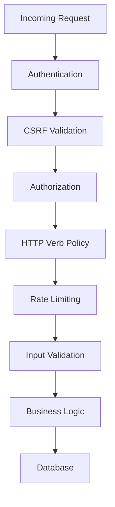

Urutan aktual harus mengikuti implementasi filter, router, dan controller. Diagram ini bukan instruksi untuk memindahkan seluruh mekanisme keamanan ke satu urutan baru.

# 12. BUSINESS MODULE ARCHITECTURE

Roadmap domain ACN ERP:

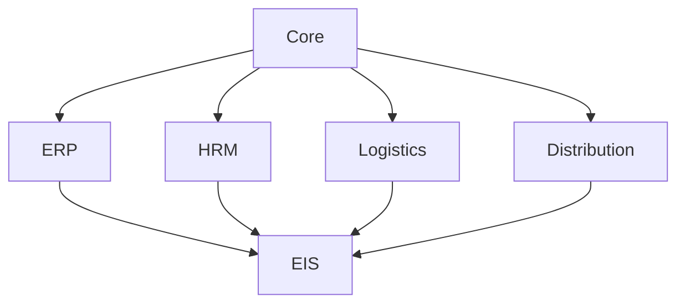

Cakupan konseptual:

| Module | Tanggung jawab |
|---|---|
| Core | Authentication, RBAC, Settings, Audit |
| ERP | Procurement, Inventory, POS, Finance |
| HRM | Employees, Attendance, Members, Simpan Pinjam |
| Logistics | Pengelolaan logistik |
| Distribution | Distribusi dan penyaluran |
| EIS | Reporting dan executive information |

Tidak semua domain di atas harus sudah tersedia sebagai module aktif. Status implementasinya harus mengacu pada source code aktual.

# 13. DATABASE ARCHITECTURE

Database menggunakan MySQL.

Prinsip:

- Database menjadi sumber data persisten.
- Relasi antarentitas harus konsisten.
- Migration menjadi mekanisme perubahan skema sesuai pola project.
- Service mengelola business transaction sesuai kebutuhan.
- Jangan melakukan perubahan skema tanpa analisis dampak.
- Jangan menghapus atau mereset data tanpa persetujuan eksplisit.

Tabel inti yang pernah dibahas:

- Tabel Shield.
- Tabel custom RBAC.
- `route_registry`.
- `route_registry_verbs`.
- `route_registry_menus`.

Daftar tersebut belum merupakan inventaris lengkap database.

# 14. DEPLOYMENT ARCHITECTURE

Lingkungan development yang diketahui:

```text
Windows
└── Laragon
    └── C:\laragon\www\cakra
        ├── CodeIgniter 4
        ├── frontend/
        └── public/
            └── acn/
                └── Vue build output
```

Frontend development menggunakan Vite.

Frontend production menggunakan hasil build yang disajikan melalui backend CI4.

Ketentuan:

- Pisahkan konfigurasi development dan production.
- API base URL harus sesuai environment.
- Jangan hardcode localhost untuk production.
- Periksa base path dan asset path sebelum deployment.
- Jangan mengubah document root atau deployment routing tanpa analisis.

# 15. CROSS-COMPONENT DEPENDENCIES

Perubahan pada satu komponen dapat memengaruhi komponen lain.

| Komponen yang berubah | Area yang harus diperiksa |
|---|---|
| DynamicRouterBase | Route Registry, API, Auth, RBAC |
| Route Registry | DynamicRouter, Permission, Navigation |
| RBAC | API, Menu, Route Access |
| Authentication | Session, CSRF, Axios, Auth Store |
| API Contract | Backend Controller, Service, Pinia Store |
| Database | Model, Service, Migration, API |
| Vue Router | Module Router, Auth Guard, Layout |
| Menu Store | Navigation API, Sidebar, Permission |
| Vite Config | Build, Asset URL, Deployment |

AI harus memeriksa dependensi yang relevan sebelum menyatakan perubahan aman.

# 16. ARCHITECTURE DECISION RECORDS

Keputusan arsitektur penting harus dicatat menggunakan format ADR.

```text
ADR ID:
Title:
Date:
Status:

Context:
Decision:
Alternatives:
Consequences:
Affected Components:
Related Changes:
```

Status:

- PROPOSED
- ACCEPTED
- REJECTED
- SUPERSEDED

Keputusan yang telah diterima tidak boleh diganti diam-diam.

# 17. ARCHITECTURE VALIDATION

Dokumen ini merupakan baseline konseptual.

Setiap bagian harus divalidasi dengan:

- Source code.
- Database migrations.
- Routes.
- Services.
- Controllers.
- Frontend modules.
- API requests and responses.
- Runtime behavior.

Jika diagram berbeda dari implementasi aktual, jangan langsung mengubah source code agar sesuai diagram.

Lakukan:
1. Identifikasi perbedaan.
2. Tentukan apakah dokumentasi yang salah atau implementasi yang perlu diperbaiki.
3. Analisis dampak.
4. Ajukan rekomendasi.
5. Tunggu persetujuan jika perubahan menyentuh keputusan arsitektur.
6. Perbarui dokumen setelah keputusan diterapkan.

# 18. ARCHITECTURE UPDATE POLICY

Dokumen harus diperbarui ketika terjadi:

- Perubahan hubungan antar-layer.
- Penambahan atau penghapusan komponen inti.
- Perubahan routing.
- Perubahan autentikasi atau otorisasi.
- Perubahan alur API.
- Perubahan frontend architecture.
- Penambahan domain bisnis utama.
- Perubahan deployment architecture.

Setiap pembaruan arsitektur harus terhubung dengan CHANGELOG dan ADR terkait.

---

# ARCHITECTURE GOVERNANCE

**Arsitektur adalah representasi sistem yang benar-benar berjalan, bukan sekadar rancangan ideal.**

AI harus mempelajari implementasi ACN ERP sebelum memberikan rekomendasi perubahan arsitektur.

Jangan memaksa source code mengikuti diagram yang belum divalidasi.

Prioritas utama adalah menjaga konsistensi, keamanan, integritas data, dan keberlanjutan pengembangan ACN ERP.