# PROJECT CONTEXT — ACN ERP

**Project:** ACN ERP  
**Organization:** PT ADI CAKRA NATA (ACN)  
**Tagline:** Integrated Commodity Ecosystem  
**Document:** PROJECT_CONTEXT.md  
**Purpose:** Menjadi sumber konteks utama bagi AI dalam memahami sistem ACN ERP.

---

# 1. PROJECT OVERVIEW

ACN ERP adalah sistem Enterprise Resource Planning yang dikembangkan secara modular menggunakan CodeIgniter 4 sebagai backend dan Vue 3 sebagai frontend.

Sistem dirancang untuk mendukung pengelolaan operasional bisnis ACN dan pengembangan ekosistem usaha terintegrasi.

Prinsip utama pengembangan:

- Modular dan terstruktur.
- Backend sebagai pusat otorisasi dan pengelolaan data.
- Frontend sebagai antarmuka pengguna.
- API sebagai kontrak komunikasi backend dan frontend.
- RBAC sebagai pusat pengaturan akses.
- Route Registry sebagai sumber pengelolaan endpoint.
- Dapat dikembangkan untuk integrasi web, mobile, dan layanan eksternal.
- Mengutamakan keamanan, konsistensi data, dan maintainability.

AI wajib memahami arsitektur yang sudah berjalan sebelum mengusulkan perubahan.

# 2. TECHNOLOGY STACK

## 2.1 Backend

| Komponen | Teknologi |
|---|---|
| Framework | CodeIgniter 4 |
| Authentication | CodeIgniter Shield |
| Settings | CodeIgniter Settings |
| Database | MySQL |
| Database development | Laragon |
| API | REST-style API |
| Backend language | PHP |

Informasi versi yang pernah digunakan:

- CodeIgniter 4.7.5
- CodeIgniter Shield 1.4.1

Versi aktual harus diverifikasi melalui file konfigurasi dan dependency project sebelum perubahan teknis dilakukan.

## 2.2 Frontend

| Komponen | Teknologi |
|---|---|
| Framework | Vue 3 |
| Build tool | Vite |
| Language | TypeScript |
| State management | Pinia |
| Routing | Vue Router |
| HTTP client | Axios |
| UI theme | Adminmart Modernize |

Preferensi implementasi:

- Vue 3 Composition API.
- `<script setup lang="ts">`.
- TypeScript strict.
- Pinia untuk state management.
- Axios melalui satu konfigurasi client terpusat.
- Vue Router untuk navigasi.
- Tidak menggunakan jQuery untuk implementasi frontend baru.
- Tidak membuat ulang fungsi yang sudah tersedia tanpa alasan teknis.

Versi dependency yang pernah digunakan:
- Vue 3.5.44
- Vite 8.3.5
- Vue Router 5.4.0
- Pinia 4.1.0
- Axios

Versi aktual wajib diperiksa melalui `package.json` dan lock file.

# 3. PROJECT DIRECTORY

Lokasi pengembangan lokal yang diketahui:

`C:\laragon\www\cakra`

Backend menggunakan struktur CodeIgniter 4.

Frontend Vue berada dalam direktori:

`frontend/`

Struktur frontend yang pernah digunakan:

```text
frontend/
└── src/
    ├── api/
    ├── modules/
    ├── router/
    ├── stores/
    ├── types/
    ├── utils/
    ├── main.ts
    └── ...
```

Frontend memiliki pendekatan modular. Setiap module dapat memiliki file router sendiri.

Contoh mekanisme auto-route yang pernah digunakan:

```ts
import.meta.glob('../modules/*/router.ts')
```

Struktur direktori backend, namespace aktual, dan seluruh module harus diverifikasi dari source code terbaru.

AI tidak boleh mengarang struktur direktori yang belum diperiksa.

# 4. BACKEND ARCHITECTURE

## 4.1 CodeIgniter Modules

Sistem menggunakan pendekatan modular dengan namespace `Modules`.

Contoh namespace API:

```php
Modules\{Module}\Controllers\Api\V1
```

Contoh pola endpoint API:

```text
/api/v1/{module}/{endpoint}
```

Pembagian tanggung jawab:

- Controller menangani HTTP request dan response.
- Service menangani business logic.
- Repository atau model menangani akses data sesuai pola yang sudah diterapkan.
- Core menangani layanan lintas module.
- Module menangani domain bisnis masing-masing.

AI harus mengikuti pola aktual yang sudah ada. Jangan memperkenalkan pola baru secara sepihak.

## 4.2 API Response Standard

API menggunakan format response standar yang pernah diterapkan:

```json
{
  "status": 200,
  "error": false,
  "message": "Success",
  "data": {},
  "csrf_token": "..."
}
```

Ketentuan:

- Pertahankan kontrak response yang sudah digunakan frontend.
- Jangan mengubah nama field tanpa persetujuan.
- Jangan membuat format response berbeda untuk setiap module tanpa kebutuhan yang jelas.
- Error response harus konsisten dengan standar API yang berlaku.

# 5. DYNAMIC ROUTER & ROUTE REGISTRY

## 5.1 DynamicRouterBase

ACN ERP memiliki sistem DynamicRouterBase untuk pengelolaan routing secara dinamis.

Komponen yang pernah dikembangkan:

- RouterConfig
- ControllerScanner
- MethodPolicy
- RouteResolver
- AuthenticationResolver
- AccessChecker
- HttpVerbPolicy
- RateLimiter
- RouterResponseHandler

Konfigurasi yang pernah digunakan mencakup:

- allowedMethods
- publicMethods
- requiredPermissions
- requiredRoles
- allowedHttpVerbs
- httpVerbExclusions
- rateLimits
- authApiExceptions
- authRequired

Pengaturan terkait pernah menggunakan Settings:

- Core.httpVerbs
- Core.checkAccess

AI wajib memeriksa implementasi aktual sebelum mengubah komponen-komponen tersebut.

## 5.2 Route Registry

Route Registry merupakan pusat pengelolaan endpoint yang ditemukan dan didaftarkan oleh sistem.

Tabel yang diketahui:

- route_registry
- route_registry_verbs

Field status yang pernah digunakan:

- is_discovered
- is_routable
- is_allowed

Endpoint API yang pernah dikembangkan:

```text
/api/v1/route-registry
```

Operasi yang pernah tersedia:

- scan
- apply
- registered
- getVerbs
- saveVerbs

HTTP verbs yang dikelola:

```text
GET
POST
PUT
PATCH
DELETE
OPTIONS
HEAD
```

Route Registry menjadi salah satu sumber acuan pengelolaan endpoint dan konfigurasi routing.

AI tidak boleh membuat sistem routing paralel atau mengabaikan Route Registry tanpa persetujuan.

# 6. AUTHENTICATION & AUTHORIZATION

## 6.1 Authentication

Sistem menggunakan CodeIgniter Shield dengan pengembangan mekanisme autentikasi yang disesuaikan dengan kebutuhan ACN ERP.

Arah implementasi frontend saat ini adalah session-based authentication untuk aplikasi Vue yang berjalan di browser.

Konfigurasi yang pernah dibahas:

- Axios `withCredentials: true`
- CSRF protection menggunakan session
- `tokenRandomize: true`
- CSRF token dikirimkan melalui response API dengan field `csrf_token`
- Client menyimpan token CSRF di memory dan mengirimkannya pada request yang memerlukan proteksi.

Endpoint autentikasi yang pernah digunakan:

```text
/api/v1/auth/login
/api/v1/auth/me
```

Payload login:

```json
{
  "identity": "username atau email",
  "password": "password",
  "remember": false
}
```

Catatan:

- Session browser menjadi arah implementasi saat ini.
- Token-based authentication untuk kebutuhan mobile atau integrasi lain merupakan pembahasan terpisah.
- Jangan mengubah mekanisme autentikasi tanpa analisis dampak dan persetujuan.

## 6.2 RBAC

ACN ERP menggunakan sistem Role-Based Access Control yang dikembangkan secara khusus.

**Prinsip penting: Shield bukan master utama definisi RBAC ACN ERP.**

Tabel yang diketahui:

- auth_groups
- auth_permissions
- auth_groups_permissions
- auth_groups_users
- auth_permissions_users

Service yang pernah dikembangkan:

- RbacService
- AccessControlService
- RouteRegistryAccessService

Group yang pernah digunakan:

| ID | Group |
|---:|---|
| 1 | superadmin |
| 2 | admin |
| 3 | User |
| 4 | developer |

Nama, ID, dan kondisi aktual wajib diverifikasi dari database.

Ketentuan RBAC:

- Backend merupakan sumber keputusan otorisasi.
- Vue tidak boleh menjadi satu-satunya lapisan keamanan.
- Menu yang disembunyikan di frontend bukan pengganti pemeriksaan permission backend.
- Permission dan role harus mengikuti sumber data RBAC ACN ERP.
- Proteksi akun superadmin/root harus dipertahankan.
- Jangan mengubah struktur tabel atau mekanisme permission tanpa persetujuan.

# 7. FRONTEND ARCHITECTURE

## 7.1 Vue Application

Frontend menggunakan Vue 3 dengan pendekatan modular.

Entry point yang pernah digunakan:

```text
frontend/src/main.ts
```

Inisialisasi aplikasi mencakup:

- createApp
- createPinia
- Vue Router
- Mount ke elemen `#app`

Module dapat mendaftarkan route melalui file:

```text
modules/*/router.ts
```

AI harus memeriksa konfigurasi router aktual sebelum menambahkan route.

## 7.2 State Management

Pinia digunakan untuk state management.

Store yang pernah dikembangkan atau direncanakan:

- auth store
- menu store
- permission store

Prinsip:

- State autentikasi dikelola secara terpusat.
- State menu tidak boleh menduplikasi sumber otorisasi backend.
- Komponen UI tidak boleh mengambil alih business logic yang seharusnya berada dalam store atau service.
- Hindari request API berulang yang tidak diperlukan.

## 7.3 API Client

Axios digunakan melalui konfigurasi client terpusat.

Ketentuan:

- `withCredentials: true` untuk session browser.
- Base URL API harus mendukung lingkungan development dan production.
- Jangan hardcode host development sebagai konfigurasi production.
- CSRF harus dikelola secara konsisten.
- Jangan membuat Axios instance baru di setiap module tanpa alasan.

## 7.4 Navigation & Menu

Menu frontend bersumber dari backend.

Prinsip:

- Backend menentukan menu yang boleh diakses pengguna.
- Menu mengikuti konfigurasi dan permission yang berlaku.
- Vue bertugas menampilkan menu.
- Layout tidak boleh menjadi pusat pengambilan keputusan RBAC.
- Jangan membuat menu statis yang menduplikasi konfigurasi backend tanpa persetujuan.

# 8. ENVIRONMENT & DEPLOYMENT

Lingkungan development yang pernah digunakan:

| Komponen | Konfigurasi |
|---|---|
| OS | Windows |
| Local server | Laragon |
| Backend project | `C:\laragon\www\cakra` |
| Local domain | `cakra.test` |
| Database | MySQL |
| Frontend dev server | Vite |
| Frontend build | Vite |

Frontend pernah menggunakan:

```text
public/acn/
```

sebagai lokasi hasil build yang disajikan oleh backend CI4.

Konfigurasi build, base path, output directory, manifest, dan URL API harus diperiksa dari konfigurasi aktual.

Target deployment:

- Development lokal.
- Production hosting.
- Kemungkinan pengembangan client mobile di masa mendatang.

Jangan menganggap konfigurasi development sama dengan production.

# 9. BUSINESS MODULE ROADMAP

Modul bisnis yang direncanakan atau menjadi bagian roadmap ACN ERP:

| Domain | Cakupan |
|---|---|
| Core | Authentication, RBAC, Settings, Audit, konfigurasi sistem |
| ERP | Procurement, Inventory, POS, Finance |
| HRM | Employee, Attendance, Member, Simpan Pinjam |
| Logistics | Pengelolaan logistik |
| Distribution | Distribusi dan jaringan penyaluran |
| EIS | Executive Information System |

Rencana tambahan yang pernah dibahas:

- Persediaan SPHP, pupuk, dan LPG 3 kg.
- Pengelolaan transaksi dan penjualan.
- GPS tracking.
- Face attendance.
- QRIS dan PPOB.
- Realtime chat.
- Integrasi aplikasi web dan mobile.

Daftar ini merupakan roadmap dan bukan bukti bahwa seluruh modul sudah selesai dibuat.

AI wajib membedakan:
- Sudah berjalan.
- Sedang dikembangkan.
- Baru direncanakan.

# 10. DATABASE GOVERNANCE

Database utama development yang pernah digunakan:

```text
cakra
```

Ketentuan:

- Jangan melakukan reset database tanpa instruksi eksplisit.
- Jangan menghapus tabel atau kolom yang sudah digunakan.
- Jangan mengubah nama tabel, kolom, index, foreign key, atau relasi tanpa analisis dampak.
- Migration harus mengikuti pola project.
- Jangan menganggap struktur database berdasarkan nama model saja.
- Periksa migration, model, service, dan skema aktual sebelum mengubah database.

# 11. DEVELOPMENT WORKFLOW

Setiap pekerjaan harus mengikuti tahapan berikut:

## Tahap 1 — Understand

Pahami kebutuhan dan tujuan perubahan.

## Tahap 2 — Inspect

Periksa source code, konfigurasi, route, service, model, database, dan frontend yang relevan.

## Tahap 3 — Analyze

Identifikasi:
- Kondisi saat ini.
- Alur kerja.
- Ketergantungan.
- Risiko regresi.
- Dampak terhadap module lain.

## Tahap 4 — Propose

Jelaskan solusi sebelum melakukan perubahan besar.

## Tahap 5 — Implement

Berikan perubahan dengan:
- Path file.
- Nama class atau function.
- Lokasi perubahan.
- Kode lengkap atau patch yang jelas.

## Tahap 6 — Verify

Berikan langkah pengujian yang dapat dijalankan.

Jangan menyatakan berhasil diuji jika belum benar-benar diuji.

## Tahap 7 — Document

Catat keputusan arsitektur dan perubahan penting agar dapat dilanjutkan pada percakapan berikutnya.

# 12. ARCHITECTURE CHANGE CONTROL

Perubahan berikut memerlukan analisis dampak dan persetujuan:

- Struktur database.
- Kontrak API.
- Authentication.
- Authorization dan RBAC.
- DynamicRouterBase.
- Route Registry.
- Struktur module.
- Mekanisme session dan CSRF.
- Konfigurasi deployment.
- Mekanisme frontend-backend communication.

Perubahan kecil yang tidak mengubah kontrak dan arsitektur dapat diusulkan langsung dengan penjelasan yang memadai.

# 13. CURRENT DEVELOPMENT STATUS

Status berikut merupakan gambaran berdasarkan diskusi sebelumnya, bukan hasil pemeriksaan source code terbaru.

| Area | Status konteks |
|---|---|
| CI4 backend | Sudah menjadi fondasi sistem |
| Shield authentication | Sudah diintegrasikan dan dikembangkan |
| Custom RBAC | Sudah memiliki desain dan implementasi awal |
| DynamicRouterBase | Sudah dikembangkan |
| Route Registry | Sudah dikembangkan |
| Vue 3 migration | Sedang dikembangkan |
| Pinia | Sudah digunakan dalam frontend |
| Axios API client | Sudah dikembangkan |
| Adminmart integration | Sedang disesuaikan |
| ERP business modules | Bertahap sesuai roadmap |

AI harus memperbarui status ini berdasarkan source code terbaru dan konfirmasi pengguna.

# 14. KNOWN ARCHITECTURAL DECISIONS

Keputusan yang harus dijaga selama pengembangan:

1. Backend tetap menjadi pusat business logic dan otorisasi.
2. Vue menjadi frontend utama yang sedang dikembangkan.
3. Custom RBAC ACN ERP menjadi acuan otorisasi, bukan konfigurasi default Shield semata.
4. Route Registry menjadi sumber pengelolaan endpoint.
5. DynamicRouterBase tidak boleh diganti dengan routing paralel tanpa persetujuan.
6. API contract harus dipertahankan.
7. Session browser merupakan arah autentikasi Vue saat ini.
8. Module harus tetap memiliki batas tanggung jawab yang jelas.
9. Perubahan dilakukan bertahap dan tidak merusak fitur yang sudah berjalan.

# 15. UNKNOWN / MUST VERIFY

AI tidak boleh mengarang atau menganggap informasi berikut sudah pasti:

- Struktur direktori backend terbaru.
- Seluruh daftar module aktif.
- Struktur database terkini.
- Isi file konfigurasi CI4.
- Konfigurasi aktual DynamicRouterBase.
- Implementasi terbaru Shield dan RBAC.
- Seluruh route API aktif.
- Isi aktual setiap Pinia store.
- Konfigurasi Vite terbaru.
- Status deployment production.
- Status penyelesaian setiap modul bisnis.

Jika informasi tersebut diperlukan untuk pekerjaan, periksa source code atau minta hanya file yang benar-benar belum tersedia.

# 16. CONTEXT UPDATE POLICY

Dokumen ini harus diperbarui ketika terjadi:

- Perubahan arsitektur.
- Penambahan module utama.
- Perubahan teknologi.
- Perubahan kontrak API.
- Perubahan authentication atau RBAC.
- Perubahan struktur database yang disetujui.
- Keputusan teknis permanen.
- Perubahan status development yang signifikan.

Jangan menimpa keputusan lama tanpa mencatat perubahan dan alasannya.

---

**PRINCIPLE**

ACN ERP adalah sistem yang berkembang secara bertahap.

AI harus memahami kondisi sistem yang sebenarnya, mempertahankan keputusan yang sudah disepakati, dan membantu mengembangkan sistem tanpa merusak fondasi yang sudah dibangun.

# ARCHITECTURE — ACN ERP

**Project:** ACN ERP  
**Document:** ARCHITECTURE.md  
**Architecture Type:** Modular Backend + SPA Frontend  
**Backend:** CodeIgniter 4  
**Frontend:** Vue 3 + TypeScript  
**Database:** MySQL  
**Purpose:** Dokumentasi arsitektur teknis dan hubungan antarkomponen ACN ERP.

---

# 1. ARCHITECTURE PRINCIPLES

Arsitektur ACN ERP mengikuti prinsip:

1. Separation of Concerns.
2. Modular Architecture.
3. Centralized Authorization.
4. Backend-driven Business Logic.
5. API-based Communication.
6. Reusable Core Services.
7. Database Integrity.
8. Minimal Coupling.
9. Controlled Extensibility.
10. Backward Compatibility.

AI harus mempertahankan prinsip tersebut ketika mengusulkan atau menerapkan perubahan.

# 2. HIGH-LEVEL SYSTEM ARCHITECTURE

Gambaran umum arsitektur:

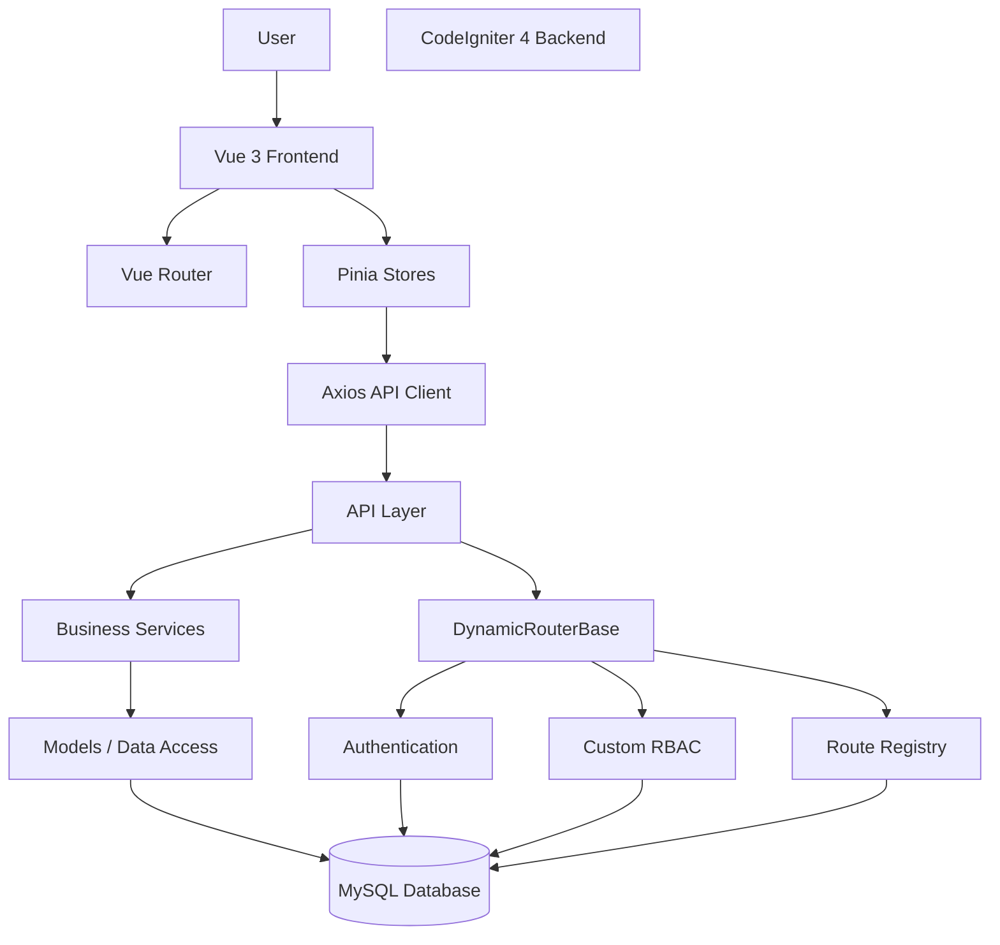

**Catatan:** Diagram ini merupakan gambaran konseptual berdasarkan pembahasan. Urutan pemanggilan aktual harus diverifikasi melalui implementasi source code.

# 3. BACKEND ARCHITECTURE

## 3.1 Backend Responsibilities

CodeIgniter 4 merupakan pusat pemrosesan backend ACN ERP.

Tanggung jawab backend:

- Authentication.
- Authorization.
- Routing.
- Validasi request.
- Business logic.
- Pengelolaan transaksi.
- Akses database.
- Audit dan logging.
- API response.
- Integrasi eksternal.

Frontend tidak boleh mengambil alih tanggung jawab keamanan dan business logic yang menjadi kewenangan backend.

## 3.2 Backend Layer Concept

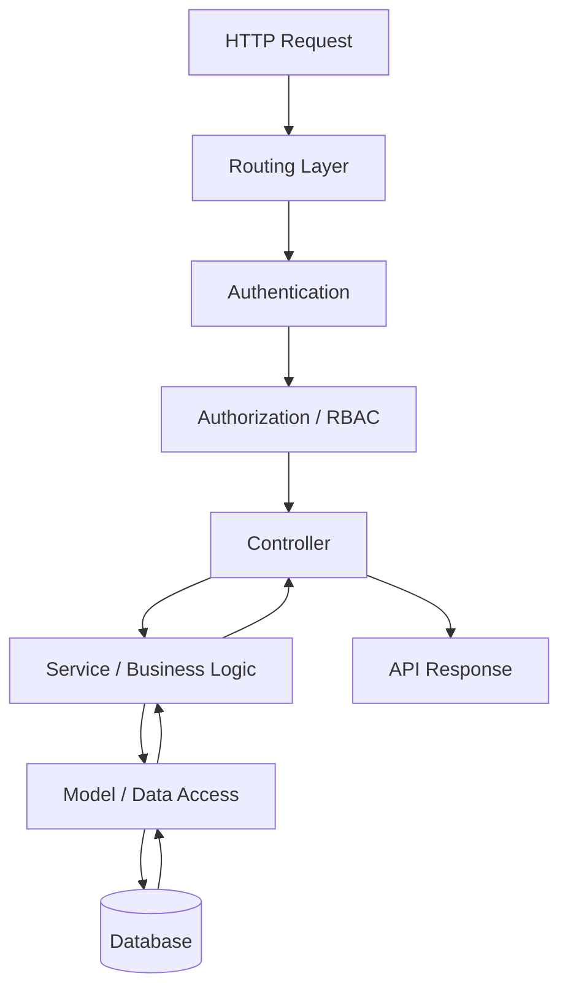

Diagram menunjukkan pemisahan tanggung jawab, bukan ketentuan bahwa seluruh endpoint harus mempunyai urutan identik.

# 4. DYNAMIC ROUTER ARCHITECTURE

DynamicRouterBase merupakan komponen penting dalam pengelolaan routing backend.

Komponen yang pernah dikembangkan:

```text
DynamicRouterBase
├── RouterConfig
├── ControllerScanner
├── MethodPolicy
├── RouteResolver
├── AuthenticationResolver
├── AccessChecker
├── HttpVerbPolicy
├── RateLimiter
└── RouterResponseHandler
```

## 4.1 Component Responsibilities

| Component | Tanggung jawab |
|---|---|
| RouterConfig | Membaca konfigurasi routing |
| ControllerScanner | Menemukan controller dan method |
| MethodPolicy | Menentukan kebijakan method |
| RouteResolver | Menentukan resolusi endpoint |
| AuthenticationResolver | Mengelola kebutuhan autentikasi |
| AccessChecker | Memeriksa hak akses |
| HttpVerbPolicy | Mengatur HTTP verbs |
| RateLimiter | Membatasi request |
| RouterResponseHandler | Menangani response routing |

## 4.2 Dynamic Routing Concept

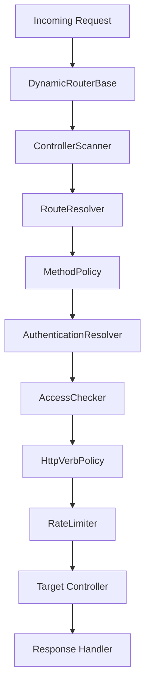

**PERLU VERIFIKASI:** Urutan aktual, kondisi bypass, exception, dan interaksi antarkomponen harus diperiksa dari source code DynamicRouterBase terbaru.

AI dilarang mengubah urutan atau kebijakan keamanan berdasarkan diagram konseptual ini saja.

# 5. ROUTE REGISTRY ARCHITECTURE

Route Registry merupakan pusat pengelolaan informasi endpoint.

Tabel yang diketahui:

```text
route_registry
route_registry_verbs
route_registry_menus
```

Fungsi utama:

- Menemukan endpoint.
- Mendaftarkan endpoint.
- Mengelola status endpoint.
- Mengatur HTTP verbs.
- Mengelola metadata endpoint.
- Menghubungkan endpoint dengan menu.

## 5.1 Registry Concept

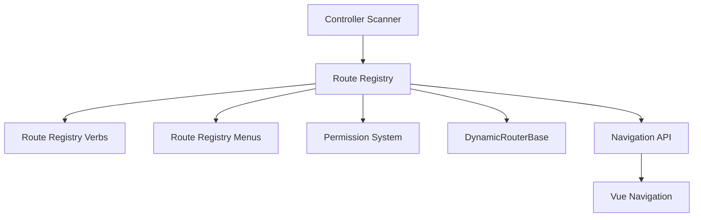

Diagram ini menggambarkan hubungan konseptual. Implementasi relasi dan alur sinkronisasi harus diverifikasi.

## 5.2 Registry Governance

- Route Registry menjadi sumber pengelolaan endpoint.
- Jangan membuat daftar endpoint paralel tanpa alasan.
- Status `is_discovered`, `is_routable`, dan `is_allowed` harus memiliki makna konsisten.
- HTTP verbs harus mengikuti kebijakan yang berlaku.
- Metadata menu harus tetap terhubung dengan endpoint sesuai relasi aktual.
- Perubahan registry harus mempertimbangkan DynamicRouterBase dan RBAC.

# 6. AUTHENTICATION ARCHITECTURE

Authentication menggunakan CodeIgniter Shield dengan penyesuaian kebutuhan ACN ERP.

Arah implementasi Vue browser saat ini adalah session-based authentication.

## 6.1 Authentication Concept

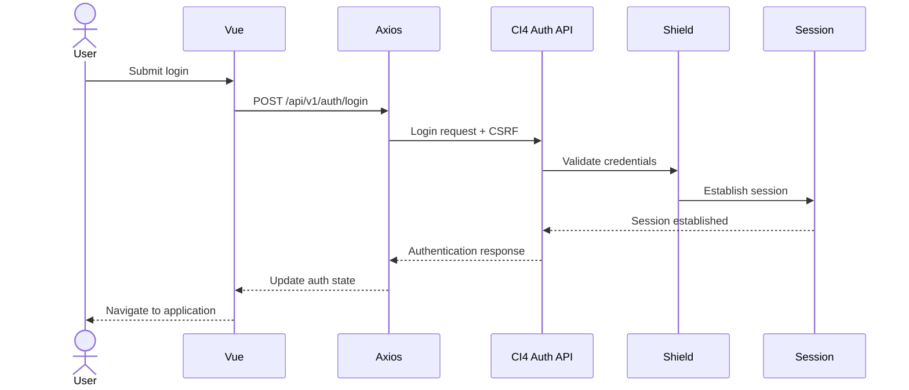

Diagram bersifat konseptual. Detail session regeneration, cookie attributes, CSRF lifecycle, dan response aktual harus diverifikasi.

## 6.2 Authentication Rules

- Backend memvalidasi identitas dan kredensial.
- Session dikelola backend.
- Frontend tidak menyimpan password.
- Authentication state frontend bukan sumber otorisasi.
- Endpoint yang memerlukan autentikasi harus memeriksa session.
- Logout harus membersihkan session sesuai mekanisme backend.

# 7. RBAC ARCHITECTURE

ACN ERP menggunakan custom RBAC.

Shield menyediakan fondasi autentikasi, sedangkan kebijakan RBAC ACN ERP dikembangkan melalui sistem tersendiri.

Komponen yang diketahui:

```text
RBAC
├── RbacService
├── AccessControlService
├── RouteRegistryAccessService
├── Groups
├── Permissions
└── User Assignments
```

## 7.1 RBAC Concept

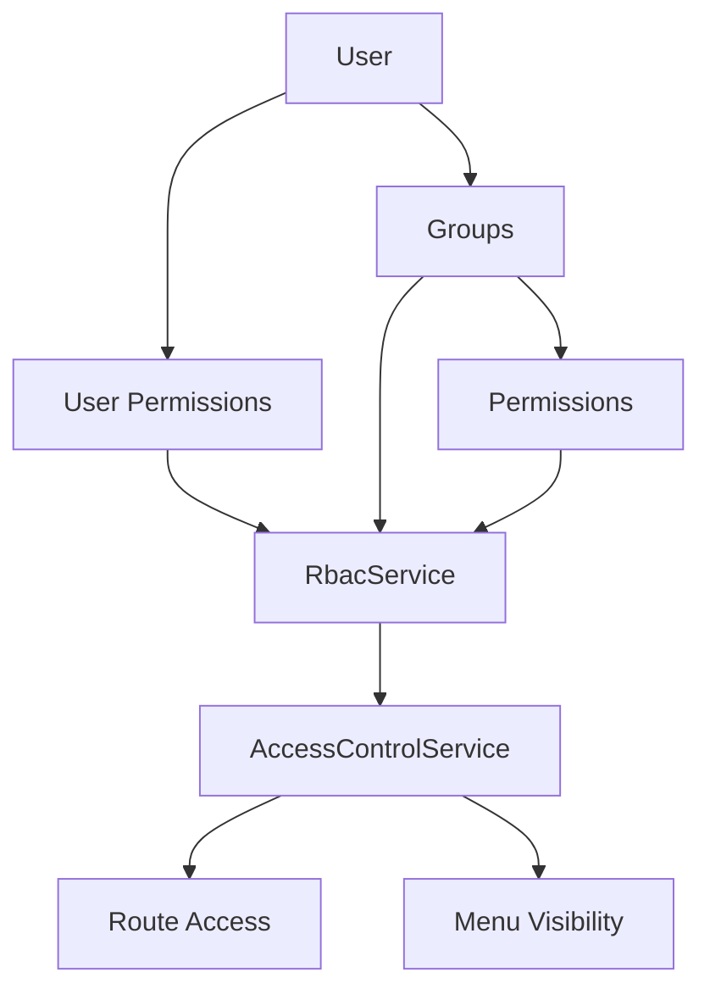

## 7.2 Authorization Rules

- Backend melakukan pemeriksaan permission.
- Menu frontend mengikuti hasil otorisasi backend.
- Route frontend bukan pengganti pemeriksaan backend.
- Permission langsung pada user dan permission dari group harus mengikuti aturan efektif yang diterapkan.
- Superadmin protection harus dipertahankan.
- Jangan mengasumsikan seluruh group otomatis mempunyai akses penuh.

**PERLU VERIFIKASI:** Prioritas permission user versus group, inheritance, deny rules, dan mekanisme override.

# 8. API ARCHITECTURE

API menggunakan pola versioning:

```text
/api/v1/{module}/{endpoint}
```

Contoh endpoint yang pernah digunakan:

```text
/api/v1/auth/login
/api/v1/auth/me
/api/v1/route-registry
```

## 8.1 API Communication

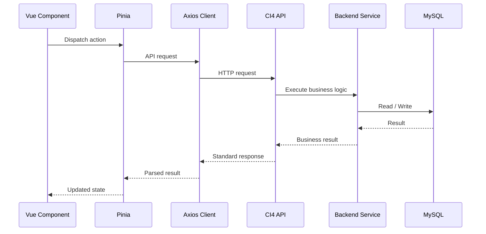

## 8.2 API Contract

Format response standar yang pernah digunakan:

```json
{
  "status": 200,
  "error": false,
  "message": "Success",
  "data": {},
  "csrf_token": "..."
}
```

Aturan:

- Pertahankan kontrak API.
- Jangan mengubah URL tanpa persetujuan.
- Validasi request di backend.
- Terapkan authorization pada endpoint yang dilindungi.
- Tangani error secara konsisten.
- Jangan membocorkan informasi internal atau kredensial.

# 9. FRONTEND ARCHITECTURE

Frontend menggunakan Vue 3, TypeScript, Pinia, Vue Router, Axios, dan Adminmart Modernize.

## 9.1 Frontend Responsibilities

- Rendering UI.
- Navigasi.
- Form interaction.
- Client-side validation untuk pengalaman pengguna.
- Pengelolaan state.
- API communication.
- Penyajian menu berdasarkan data backend.
- Pengelolaan tampilan berdasarkan hak akses.

Frontend tidak menjadi sumber kebenaran untuk permission dan business rules.

## 9.2 Frontend Component Relationship

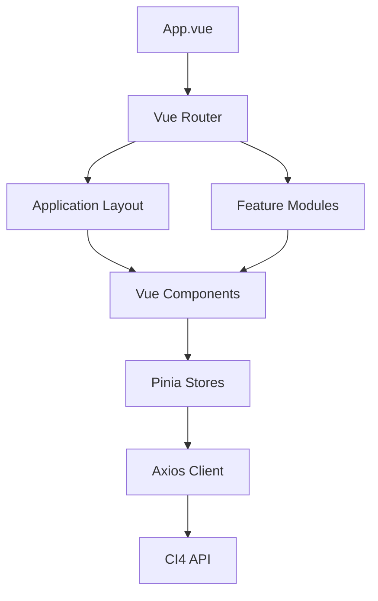

## 9.3 Module Routing

Setiap module dapat mempunyai file router tersendiri.

Pola yang pernah digunakan:

```text
frontend/src/modules/*/router.ts
```

Pendaftaran route dilakukan melalui mekanisme auto-discovery yang harus diverifikasi dari implementasi router terbaru.

# 10. MENU & NAVIGATION ARCHITECTURE

Menu ACN ERP mengikuti konfigurasi backend.

Konsep alur:

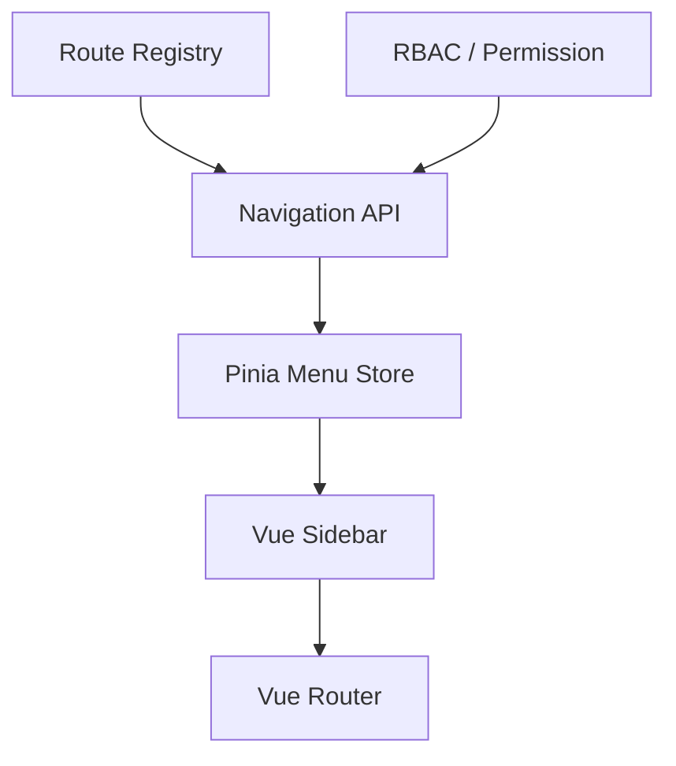

Prinsip:

- Backend menentukan menu yang dapat diberikan kepada user.
- Vue menampilkan menu.
- Sidebar tidak melakukan perhitungan RBAC sendiri.
- Route frontend harus tetap memiliki guard untuk pengalaman navigasi.
- Backend tetap memvalidasi setiap request yang dilindungi.

# 11. SECURITY ARCHITECTURE

Lapisan keamanan sistem meliputi:

1. Authentication.
2. Session management.
3. CSRF protection.
4. Authorization / RBAC.
5. HTTP verb policy.
6. Rate limiting.
7. Input validation.
8. Database integrity.
9. Secure error handling.
10. Audit logging.

Diagram konseptual:

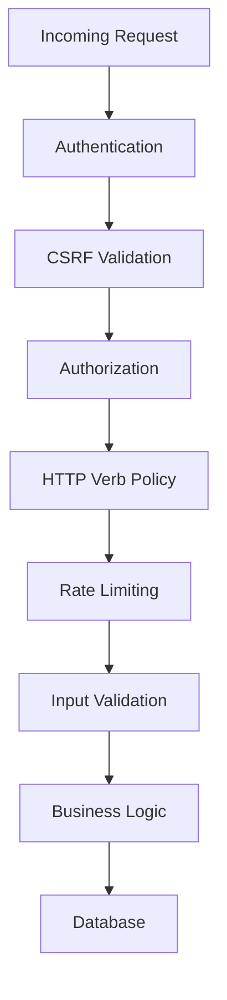

Urutan aktual harus mengikuti implementasi filter, router, dan controller. Diagram ini bukan instruksi untuk memindahkan seluruh mekanisme keamanan ke satu urutan baru.

# 12. BUSINESS MODULE ARCHITECTURE

Roadmap domain ACN ERP:

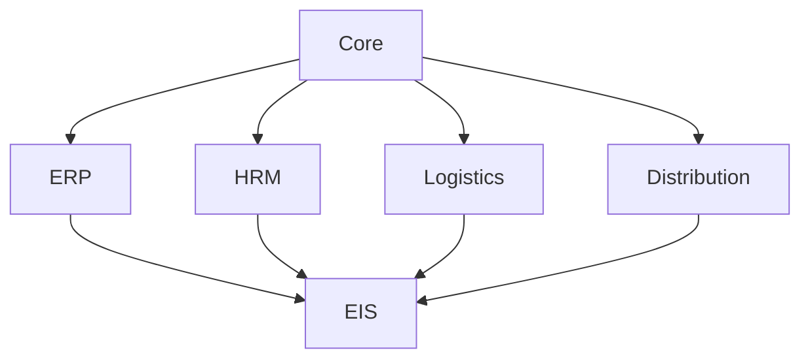

Cakupan konseptual:

| Module | Tanggung jawab |
|---|---|
| Core | Authentication, RBAC, Settings, Audit |
| ERP | Procurement, Inventory, POS, Finance |
| HRM | Employees, Attendance, Members, Simpan Pinjam |
| Logistics | Pengelolaan logistik |
| Distribution | Distribusi dan penyaluran |
| EIS | Reporting dan executive information |

Tidak semua domain di atas harus sudah tersedia sebagai module aktif. Status implementasinya harus mengacu pada source code aktual.

# 13. DATABASE ARCHITECTURE

Database menggunakan MySQL.

Prinsip:

- Database menjadi sumber data persisten.
- Relasi antarentitas harus konsisten.
- Migration menjadi mekanisme perubahan skema sesuai pola project.
- Service mengelola business transaction sesuai kebutuhan.
- Jangan melakukan perubahan skema tanpa analisis dampak.
- Jangan menghapus atau mereset data tanpa persetujuan eksplisit.

Tabel inti yang pernah dibahas:

- Tabel Shield.
- Tabel custom RBAC.
- `route_registry`.
- `route_registry_verbs`.
- `route_registry_menus`.

Daftar tersebut belum merupakan inventaris lengkap database.

# 14. DEPLOYMENT ARCHITECTURE

Lingkungan development yang diketahui:

```text
Windows
└── Laragon
    └── C:\laragon\www\cakra
        ├── CodeIgniter 4
        ├── frontend/
        └── public/
            └── acn/
                └── Vue build output
```

Frontend development menggunakan Vite.

Frontend production menggunakan hasil build yang disajikan melalui backend CI4.

Ketentuan:

- Pisahkan konfigurasi development dan production.
- API base URL harus sesuai environment.
- Jangan hardcode localhost untuk production.
- Periksa base path dan asset path sebelum deployment.
- Jangan mengubah document root atau deployment routing tanpa analisis.

# 15. CROSS-COMPONENT DEPENDENCIES

Perubahan pada satu komponen dapat memengaruhi komponen lain.

| Komponen yang berubah | Area yang harus diperiksa |
|---|---|
| DynamicRouterBase | Route Registry, API, Auth, RBAC |
| Route Registry | DynamicRouter, Permission, Navigation |
| RBAC | API, Menu, Route Access |
| Authentication | Session, CSRF, Axios, Auth Store |
| API Contract | Backend Controller, Service, Pinia Store |
| Database | Model, Service, Migration, API |
| Vue Router | Module Router, Auth Guard, Layout |
| Menu Store | Navigation API, Sidebar, Permission |
| Vite Config | Build, Asset URL, Deployment |

AI harus memeriksa dependensi yang relevan sebelum menyatakan perubahan aman.

# 16. ARCHITECTURE DECISION RECORDS

Keputusan arsitektur penting harus dicatat menggunakan format ADR.

```text
ADR ID:
Title:
Date:
Status:

Context:
Decision:
Alternatives:
Consequences:
Affected Components:
Related Changes:
```

Status:

- PROPOSED
- ACCEPTED
- REJECTED
- SUPERSEDED

Keputusan yang telah diterima tidak boleh diganti diam-diam.

# 17. ARCHITECTURE VALIDATION

Dokumen ini merupakan baseline konseptual.

Setiap bagian harus divalidasi dengan:

- Source code.
- Database migrations.
- Routes.
- Services.
- Controllers.
- Frontend modules.
- API requests and responses.
- Runtime behavior.

Jika diagram berbeda dari implementasi aktual, jangan langsung mengubah source code agar sesuai diagram.

Lakukan:
1. Identifikasi perbedaan.
2. Tentukan apakah dokumentasi yang salah atau implementasi yang perlu diperbaiki.
3. Analisis dampak.
4. Ajukan rekomendasi.
5. Tunggu persetujuan jika perubahan menyentuh keputusan arsitektur.
6. Perbarui dokumen setelah keputusan diterapkan.

# 18. ARCHITECTURE UPDATE POLICY

Dokumen harus diperbarui ketika terjadi:

- Perubahan hubungan antar-layer.
- Penambahan atau penghapusan komponen inti.
- Perubahan routing.
- Perubahan autentikasi atau otorisasi.
- Perubahan alur API.
- Perubahan frontend architecture.
- Penambahan domain bisnis utama.
- Perubahan deployment architecture.

Setiap pembaruan arsitektur harus terhubung dengan CHANGELOG dan ADR terkait.

---

# ARCHITECTURE GOVERNANCE

**Arsitektur adalah representasi sistem yang benar-benar berjalan, bukan sekadar rancangan ideal.**

AI harus mempelajari implementasi ACN ERP sebelum memberikan rekomendasi perubahan arsitektur.

Jangan memaksa source code mengikuti diagram yang belum divalidasi.

Prioritas utama adalah menjaga konsistensi, keamanan, integritas data, dan keberlanjutan pengembangan ACN ERP.